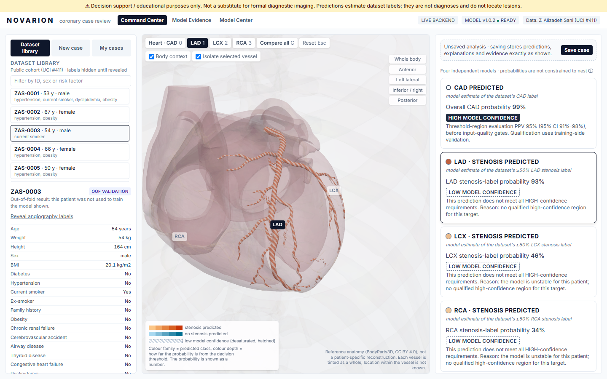
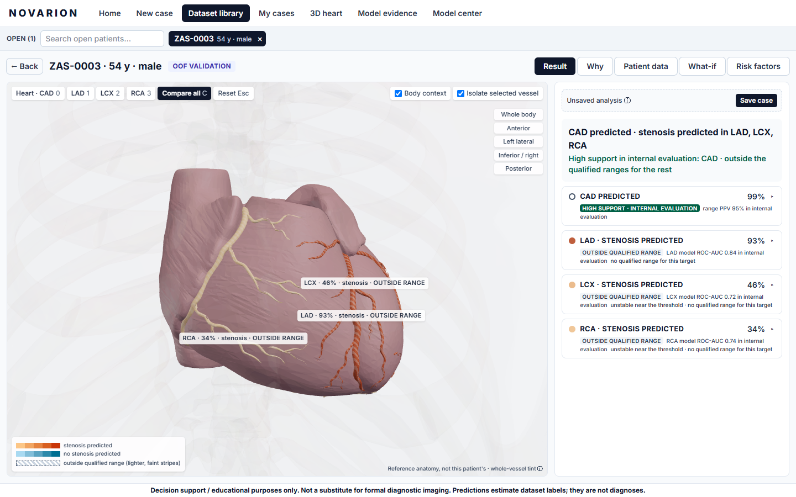
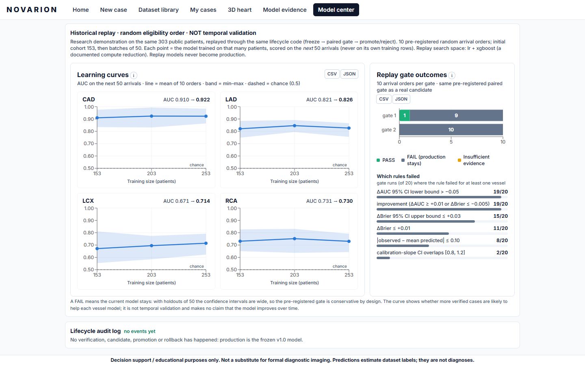

# NOVARION

**A new light on every coronary artery.** A 3D coronary case-review system for the Multimodal AI Hackathon 2026,
Track A (Cardiovascular Risk Visualization & Prediction).

> ⚠️ **Decision support / educational purposes only. Not a substitute for formal diagnostic imaging.**
> Predictions estimate the probability of the dataset's CAD / ≥50% vessel-stenosis labels from routine clinical
> features. They are not diagnoses, do not locate lesions, and do not recommend tests or treatment.

NOVARION predicts overall **CAD** and **LAD / LCX / RCA stenosis** for the 303 patients of the Extension of Z-Alizadeh
Sani dataset (UCI #411). It colours each vessel of an interactive 3D heart by its calibrated probability and explains
every prediction with exact SHAP contributions beside the patient's measurements. Around that it builds a review
workflow: case → quality gate → 3D review → human note → hash-verified Review Snapshot → case history. A governed
learning loop lets verified outcomes reach a model update only through a validation gate and human approval.



| Compare all vessels | Model Center |
|---|---|
|  |  |

## Run it

**Docker (recommended):** this needs a built model bundle; see *Reproduce* below.

```bash
docker compose up -d --build        # → http://localhost:8080   (backend :8000, READY in ~15 s)
```

**Development:**

```bash
uv python install 3.11 && uv sync --all-groups
make serve                          # real API on :8000 (fails closed without a verified bundle)
cd frontend && npm ci && npm run dev   # http://localhost:5173
```

**Sign-in (optional):** create an account with `uv run python scripts/users.py add NAME` (it asks for the password
twice and stores only a salted scrypt hash in the gitignored `artifacts/users.json`), then restart the backend.
While that file exists, the app opens on a sign-in page and the API refuses requests without a session; delete it
to turn sign-in off (D-022).

When the backend is unreachable, the frontend switches to **offline demo mode**. It loads a hash-verified static
bundle and shows the "OFFLINE DEMO" badge. All dataset-patient flows keep working; live inference is
disabled and says why.

**Reproduce everything:** `make reproduce` runs data download (checksum-pinned) → nested CV → stability bootstrap →
model bundle → replay study. It takes about 2–4 h on a laptop. Seeds, split manifest, training-matrix hash and
per-file artifact hashes are all recorded. **Verified:** a full run on a fresh clone reproduced every fold, metric,
golden prediction, stability interval and replay result exactly (`results/reproduction.json`). Compare your own run
with `uv run python scripts/compare_reproduction.py --other PATH_TO_YOUR_CLONE`.

## Results

These are for model **v1.0.2**: the same models as the frozen v1.0.0, plus stability intervals and fold-safe
evidence ledgers (D-017, D-019). Validation
is nested CV with 5 × 5 outer folds; the full tables are in `results/tables.md`.

| Target | Prevalence | ROC-AUC (outer-fold mean ± SD) | Balanced accuracy | Brier | High support as displayed (after every gate) |
|---|---|---|---|---|---|
| CAD | 71.3% | 0.930 ± 0.035 | 0.860 ± 0.051 | 0.095 | 44.6% high-positive (PPV 98.5%; 61.7% / PPV 94.7% in the threshold regions before the gates) |
| LAD | 58.4% | 0.838 ± 0.046 | 0.758 ± 0.044 | 0.161 | 0%: outside the qualified range (no qualified region) |
| LCX | 39.3% | 0.721 ± 0.067 | 0.666 ± 0.067 | 0.209 | 0%: outside the qualified range (no qualified region) |
| RCA | 37.6% | 0.736 ± 0.037 | 0.666 ± 0.042 | 0.200 | 0%: outside the qualified range (no qualified region) |

Every prediction is a binary STENOSIS / NO STENOSIS call. **Model confidence** is HIGH only inside a probability
region whose Wilson-95% lower bound met the pre-registered PPV ≥ 0.90 / NPV ≥ 0.95. These targets were fixed before
results and never lowered (D-008).

Confidence is also forced outside the qualified range (the LOW tier) in two cases:

- **Unknown inputs or an atypical profile.**
- **An unstable dataset patient.** A patient is unstable when their refit-bootstrap stability interval straddles the
  threshold (D-017). This affects 27 of 187 HIGH-confidence CAD patients.

As displayed after all these gates, the CAD HIGH badge covers 44.6% of patients at PPV 98.5% [96.2–100]
(Table 2b in `results/tables.md`).

**Against the guideline pretest score** (Table 6): on the 273 patients with a chest-pain type, NOVARION's CAD
AUC is 0.935 vs 0.852 for the updated Diamond–Forrester score (ΔAUC +0.083 [0.042, 0.127]) and 0.890 for the same
three inputs refit (+0.045 [0.012, 0.083]). Its Brier score is better than both (0.089 vs 0.103 for the refit; Brier
mixes discrimination and calibration). It is better calibrated than the published historical score, but not than the
refit three-input model (ECE 0.059 vs 0.046; calibration slope 0.88 vs 0.98). Performance is lower in patients aged 65 and
over (Table 7, subgroups).

**Also measured:**
- **Model agreement** (Table 3b): when LR, EBM, XGBoost and CatBoost disagree on a held-out patient, the selected
  model errs far more often (CAD 35% vs 9%, LAD 46% vs 19%).
- **Label-permutation test** (1,000 shuffles, Table 1b): every target beats all 1,000 label shuffles (p = 0.001,
  the smallest attainable value; CV AUC 0.936 / 0.844 / 0.714 / 0.730 vs null ≈ 0.50 ± 0.05).

**Performance** (`results/perf.json`):
- `/predict` p95: 104 ms on the Docker stack (budget 200 ms; median 64 ms).
- 3D frame rate: median 59.9 fps on Intel Iris Xe integrated graphics.
- Backend memory: 178 MB after start, 184 MB peak under load.
- Offline bundle: 3.5 MB gzipped. Browser JS heap: 13 MB after opening 30 patients.
- Browser E2E: 64 flows pass against the mock and on the Docker stack with the real model (Edge), including axe
  accessibility checks; the earlier 50-flow suite also ran in Chrome and Firefox.

## How it works

```
UCI #411 (SHA-256 pinned) → feature registry + leakage guard (Cath/CAD/LAD/LCX/RCA never inputs)
  → nested CV: LR · EBM · XGBoost · CatBoost, 92 pre-registered configs, 1-SE rule → Platt (a > 0 guard)
  → Layer A threshold (Youden) + Layer B confidence regions (Wilson bounds) → exact SHAP in calibrated log-odds
  → versioned, hash-verified bundle (OOF serving: each dataset patient is shown by the fold model that never saw them)
  → FastAPI (strict Pydantic contract → OpenAPI → generated TypeScript types)
  → React 19 + React Three Fiber (BodyParts3D anatomy, anatomy map binds target ↔ vessel ↔ camera)
  → IndexedDB case store · Review Snapshots (RFC 8785 + SHA-256) · offline static bundle
```

### Exploring a case

- **3D heart page** (D-025): the reference heart on its own, with no patient and no prediction, so the anatomy can be
  explored first. Click an artery (or use the buttons and camera views) to read its course, what it supplies and how
  NOVARION uses it. Its selection is private, so it never changes an open case.
- **One workspace per open patient** (D-023): every dataset patient, new case or reopened saved case opens in its
  own workspace and keeps its own tab, selected vessel and, for a new case, its typed values and live prediction. A
  bar under the header lists the open workspaces, with a close button on each and a search box that finds an open
  patient by ID, case number, sex, age or risk factor (or offers to open a dataset patient that isn't open yet).
- **What-if sensitivity** (new and edited cases): one input at a time is varied across its training range and the
  probability curve is drawn against the threshold. Age and sex are locked. It is labelled "model sensitivity, not
  treatment simulation", and Unknown inputs that could flip the predicted class are listed.
- **Stability bars:** each dataset patient's card shows the refit-bootstrap interval against the decision threshold.
- **Cases stay safe in the browser:** automatic local backups (last 3, in a separate store), damaged-storage
  detection that never deletes anything, and delete with confirmation.

### Governed learning loop

The loop is designed for continual supervised updating as verified cases accumulate. It never learns from its own
predictions, and the production model never changes silently.

1. A reviewer records the angiographic outcome on a saved case. The browser can only store it as `pending`, bound to
   that exact input hash.
2. **Export learning package.** The file holds allowlisted fields only: no notes, names, dates or identifiers.
3. `make verify-outcomes`: the model steward checks label definitions, provenance, timing, conflicts and duplicates.
4. `make candidate`:
   - the newest verified cases form an untouched forward holdout;
   - a challenger is trained with the same procedure, then frozen;
   - a **pre-registered paired gate** (`config/promotion_gate.yaml`) compares it with production.
5. A person runs `make promote` (gate PASS only) or `make reject`. `make rollback` restores any earlier immutable
   bundle. Every step is appended to a hash-chained audit log (`make verify-log`).

**Historical replay** (a research demonstration, *not* temporal validation): the same 303 patients are replayed in 10
random arrival orders through the same lifecycle code. LCX improves as cases accumulate (AUC 0.671 → 0.714), and the
other targets plateau. The gate promoted a challenger in only 1 of 20 replays, because with 50-patient holdouts the
paired intervals are wide. That conservatism is by design.

## Documents

| Document | Contents |
|---|---|
| [`docs/report.pdf`](docs/report.pdf) | Project report, 4 pages, every number generated from `results/` |
| [`docs/compliance.md`](docs/compliance.md) | Track A compliance audit, item by item, with evidence |
| [`docs/model_card.md`](docs/model_card.md) | Model card |
| [`docs/tripod_ai.md`](docs/tripod_ai.md) | TRIPOD+AI reporting checklist |
| [`docs/decisions.md`](docs/decisions.md) | Decision log D-001…D-021 |
| [`docs/audit/`](docs/audit/README.md) | External audit by MysteryMindz (PR #1), integrated in D-019 |
| [`results/error_analysis.md`](results/error_analysis.md), [`results/eda.md`](results/eda.md) | Error analysis and EDA |
| `results/ablation.json` | Feature-group ablation |
| `results/stability.json` | Stability bootstrap intervals |
| `results/replay.json` | Replay study |
| `results/perf.json` | Performance and memory measurements |
| `results/reproduction.json` | Fresh-clone reproduction check |
| `results/model_agreement.json`, `results/permutation.json` | Model agreement and label-permutation test |
| `results/clinical_evaluation.json` | Guideline comparator, subgroups, calibration and decision curves |

## Tests

```bash
make test                                        # 190 Python tests
cd frontend && npm run typecheck && npm run lint && npm test && npx playwright test   # 24 unit + 50 E2E (mock API)
make docker-e2e                                  # the same E2E flows against the Docker stack + real model
# Port 8000 or 5173 busy? E2E_API_PORT=8010 E2E_WEB_PORT=5180 npx playwright test; NOVARION_API_PORT=8001 docker compose up
```

## Status

**Release v1.0.4 (frozen; `release_manifest.json`, git tag `v1.0.4`), serving model v1.0.2.** Built:
- every feature of the plan's Tiers 1, 1P and 2, plus Tier 3: what-if sensitivity, input uncertainty, model
  agreement, permutation test, stability visuals and a local-only Promote wrapper;
- the verification gates: GitHub CI green, fresh-clone reproduction exact, the Docker stack verified (64/64 browser
  flows), performance and memory budgets met, browser storage hardening and the secret scan (D-020).

**New since release v1.0.2 (the model is unchanged):** a sign-in page with
real accounts, a home screen with one NEW CASE button, a tabbed interface (each case: Result · Why · Patient data · What-if; Model evidence: Summary ·
Performance · Confidence tiers · Curves · vs guideline score) (D-022), and one workspace per open patient with a
search bar (D-023) in v1.0.3; in v1.0.4, confidence shown as "validated high" or "standard" with the model's tested
accuracy beside each prediction (D-024), and a 3D heart page with the anatomy alone (D-025). Verified: 198 Python tests, 24 unit tests and 64 browser flows, against the mock and against the
rebuilt Docker stack with the real model.

Still open, for the team:
- the second-machine run;
- rehearsals and an outside-user usability test;
- the demo video;
- a public hosted URL, if the submission requires one.

Any change to the model, features, anatomy, thresholds, explanations, API or demo patients now needs a new version
(v1.0.5 and up) with its own release manifest (`scripts/release_manifest.py --version X.Y.Z --final`).

## Data and credits

The data is the Extension of Z-Alizadeh Sani dataset, UCI Machine Learning Repository #411 (CC BY 4.0): 303 records ×
59 columns, with no missing values. The 3D anatomy comes from BodyParts3D, © The Database Center for Life Science
(CC BY 4.0). See `CREDITS.md` for both.
